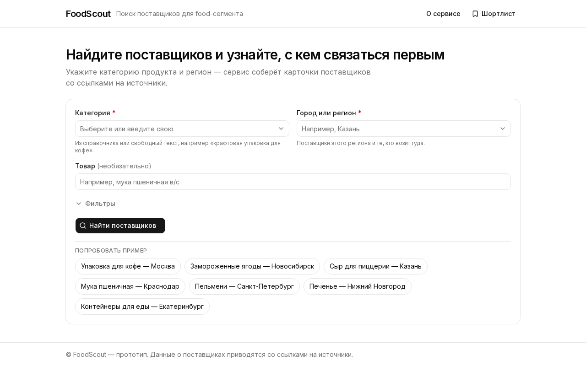
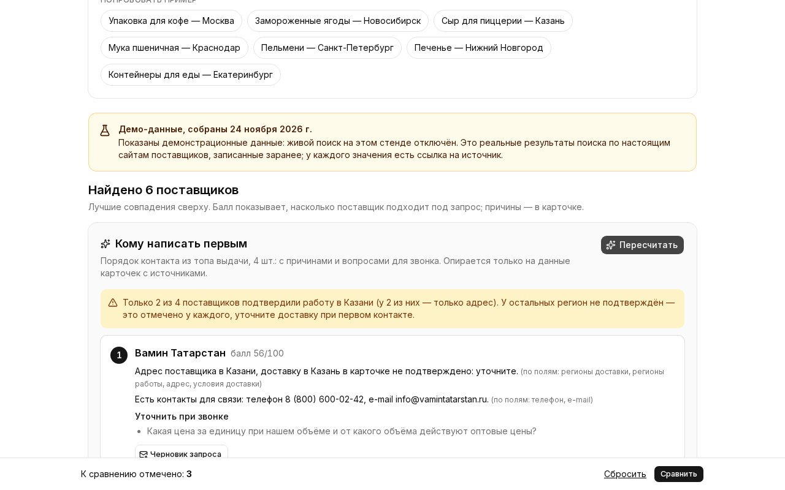
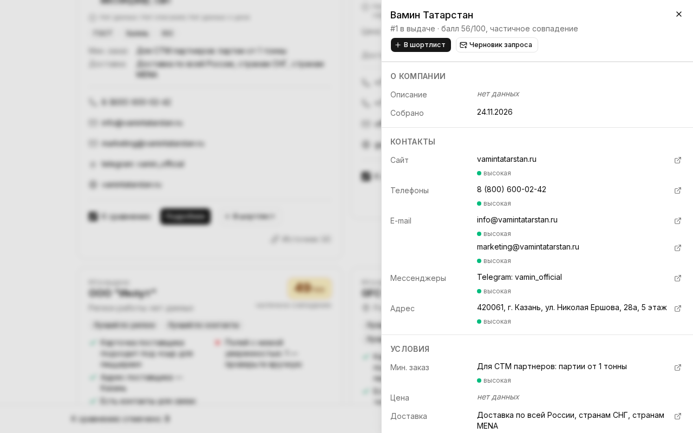
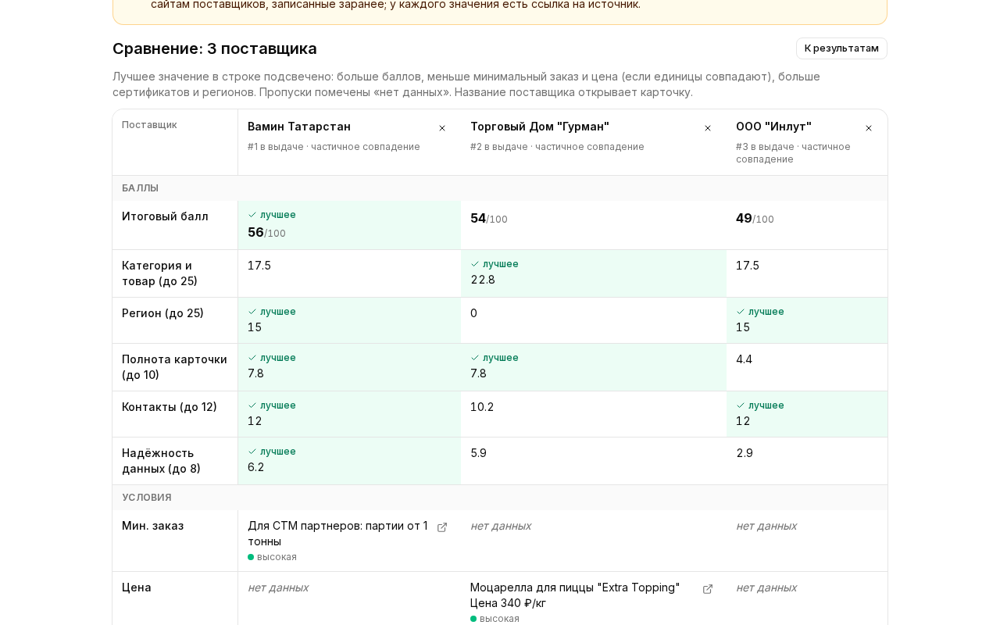

# FoodScout — поиск и сравнение поставщиков для food-сегмента

Прототип: **{PROD_URL}** · Репозиторий: https://github.com/Selogaz/foodscout

FoodScout помогает закупщику, технологу или владельцу небольшого food-бизнеса найти поставщиков
ингредиентов, готовой продукции и упаковки в нужном городе или регионе, собрать по ним
структурированные карточки со ссылками на источники и понять, **кому написать первым**.

Для телефонов, цен, минимального заказа и сертификатов сервис проверяет сведения по тексту сайта поставщика. В карточке видны источник и уровень уверенности. Пустые поля помечены «нет данных».

## Как попробовать за минуту

1. Откройте прототип и нажмите любую кнопку «Попробовать пример»: записанный заранее результат
   настоящего поиска появится сразу, с пометкой «Записанный пример, собраны <дата>».
2. Введите **свой** запрос (категория + город). В режиме `auto` с ключами запустится живой поиск с прогрессом по шагам. В семи записанных прогонах он занимал 32–50 секунд. При исчерпании лимита, ошибке или таймауте появится ближайший записанный пример с пояснением.

## Сценарий использования

Скриншоты сняты в демо-режиме на 1280 px.

**1. Задаёте запрос.** Категория (из справочника или свободный текст), город или регион, при
желании товар и фильтры: сертификаты, максимальный минимальный заказ (МОЗ), доставка, важность цены.
Состояние формы хранится в адресе страницы, поэтому запросом можно поделиться.



**2. Получаете выдачу с объяснениями.** Поставщики отсортированы по баллу; у каждого написано, что
совпало («Адрес поставщика — Казань», «Есть контакты для связи») и чего не хватает («Доставка в Казань
не указана»). Балл детерминированный, без участия модели.


**3. Узнаёте, кому написать первым.** Блок «Кому написать первым» предлагает порядок контакта с
причинами, оговорками по региону и вопросами для первого звонка. Для каждого поставщика можно
составить черновик запроса коммерческого предложения (копировать или открыть в почте).



**4. Проверяете карточку.** Детальная карточка показывает все поля, и у каждого значения есть
уровень уверенности и ссылка на страницу, откуда оно взято.



**5. Сравниваете и сохраняете.** До пяти поставщиков в одной таблице, лучшее значение в строке
подсвечено. Подходящих добавляете в шортлист: статус работы, теги, заметки, выгрузка в CSV.



## Как это работает


Шаги пайплайна (`src/server/pipeline`), прогресс каждого шага стримится в интерфейс:

1. **Нормализация.** Свободный запрос превращается в несколько поисковых фраз; место приводится к
   справочнику регионов и коду региона Яндекса (`lr`).
2. **Поиск.** Yandex Search API с параметром `lr`; из выдачи убираются агрегаторы, маркетплейсы и
   розничные сети: нужны сами поставщики.
3. **Загрузка страниц.** Свой код: таймауты, лимит размера, уважение к `robots.txt`, поиск страниц
   «контакты», «доставка», «оптовикам», «о компании».
4. **Извлечение.** Модель возвращает JSON строго по схеме (Zod): название, контакты, МОЗ, цена,
   сертификаты, доставка, регионы работы. К каждому значению обязательна **цитата** из текста страницы.
5. **Проверка цитат кодом.** Сервис ищет цитату на странице и проверяет числа и единицы по её тексту. Для минимального заказа нужно подтвердить количество или единицу. Цитаты о доставке и самовывозе отбрасываются. Совпадение по отдельным словам снижает уверенность. Для описания и условий доставки допустим пересказ по тексту страницы с низкой уверенностью.
6. **Дедупликация и валидация.** Одна компания — одна карточка (совпадение по домену, телефону или e-mail),
   значение без источника не принимается схемой данных.
7. **Скоринг.** Веса критериев — категория и товар 25, регион 25, фильтры запроса 20, контакты 12, полнота карточки 10, надёжность данных 8. Сумма набранных баллов делится на сумму активных весов (100 с фильтрами, 80 без них) и умножается на 100 и на `0,2 + 0,8 × совпадение категории и товара`. Совпадение принимает значения от 0 до 1. Итог округляется до целого. Отсутствие данных по запрошенному условию даёт за него 0 баллов. Недостающие сведения перечисляются отдельно.

### Защита от выдумок

- Схема данных запрещает значение без URL источника и без уровня уверенности.
- Цитату проверяет код, а не модель; на эвале моделей именно так отсеялась «дорисовка» (цена с соседней
   позиции, город компании в регионах доставки).
- Промпт требует, чтобы каждое число, единица и место стояли в цитате.
- Модель не ранжирует: балл считает детерминированная функция, и он воспроизводим.
- В интерфейсе единственный способ показать поле — компонент, который выводит либо «нет данных»,
  либо значение с уверенностью и ссылкой.

### Помощник «Кому написать первым»

Модель получает только факты с источниками и возвращает порядок контактов с причинами. Код
проверяет ответ: все ссылки на поставщиков и поля существуют, числа в тексте есть в данных,
«подтверждён ли регион» считается кодом, а не моделью. При любом сбое (нет ключа, таймаут, невалидный
ответ, лимит) пользователь получает шаблонный ответ без модели, а не ошибку. Черновик письма с запросом
КП собирается из шаблона; модель пишет только короткое вступление.

### Демо-режим

Режим задаётся переменной `DEMO_MODE`:

| Значение | Поведение |
|---|---|
| `auto` | Запрос, точно совпавший с записанным примером (кнопки под формой), отдаётся из записи мгновенно и бесплатно. Собственный запрос идёт в живой поиск; при отсутствии ключа, ошибке, таймауте или исчерпанном суточном лимите показываются записанные данные с пометкой причины |
| `on` | Только записанные данные, сеть и ключи не нужны (так проверяющий всегда откроет прототип) |
| `off` | Только живой поиск; ошибка не заменяется демо |

Записано 7 реальных прогонов (32 карточки); из них убраны личные данные физических лиц, ИП и розничные
сети. Если запрос не совпал с записью, демо подберёт ближайший по категории и региону и скажет об этом
в пометке; скоринг при этом считается заново под фильтры пользователя.

## Почему такой формат

**Веб-сервис на Next.js с LLM-пайплайном.** Задача — не чат, а рабочий инструмент: найти, сравнить,
выбрать, сохранить. Это определило формат (по критериям задания):

- **Понятность идеи.** Один экран: запрос → список → решение. Работа сервиса объяснима без чтения
  кода: каждый балл и каждое поле сопровождаются причинами и источниками.
- **Логика работы.** Конвейер из проверяемых шагов; модель делает только то, что нельзя сделать
  правилами (разобрать текст сайта), а всё остальное (проверка, дедупликация, ранжирование) — код.
- **Удобство.** Живой поиск показывает прогресс по шагам и сайтам, ошибки и пустая выдача объяснены
  по-русски, состояние формы в ссылке, мобильная вёрстка, клавиатурная навигация и проверки
  доступности.
- **Полнота.** Все обязательные и расширенные поля из задания, плюс сравнение, шортлист и помощник.
- **Применимость.** Провайдеры спрятаны за интерфейсами `SearchProvider` и `LlmProvider`: сменить
  поисковик или модель — вопрос конфигурации; любой OpenAI-совместимый endpoint подключается переменными
  окружения. Веб-формат не требует установки, открывается у проверяющего по ссылке.

**Почему Яндекс.** Для российских поставщиков, часто небольших региональных производств с простыми
сайтами, качество определяется индексом поиска, а не моделью. У Яндекса лучший индекс Рунета,
нативный фильтр региона (`lr` — коды городов и регионов РФ), он доступен из России с оплатой в рублях,
а модели Yandex AI Studio подключаются по OpenAI-совместимому API. Зарубежные поисковые API с веб-поиском
недоступны проверяющему из РФ без обходных путей, и для Рунета у них индекс слабее.

### Выбор модели: мини-эвал

10 реальных сайтов (9 поставщиков и 1 агрегатор как отрицательный пример), страницы заморожены, у всех
моделей одинаковые вход и промпт, JSON по схеме, `temperature 0`. Разметка выполнена вручную. Исходные страницы и эталонная разметка этого эвала не публикуются.

| Модель | Точность полей | Выдуманные цитаты | Неподтверждённые значения | Время на сайт | Цена на 10 сайтов |
|---|---|---|---|---|---|
| Qwen3.6 35B A3B | 96,8 % | 3 из 97 | 18,6 % | 1,9 с | 14,6 ₽ |
| **DeepSeek V4.1 Flash** | **98,4 %** | **0 из 117** | 15,4 % | 8,3 с | 30,1 ₽ |
| DeepSeek V4.1 Flash, промпт v2 | 98,4 % | 0 из 104 | 10,6 % | 9,7 с | 36,4 ₽ |
| Alice AI LLM | 80,0 % | 0 из 77 | 10,4 % | 17,1 с | 35,4 ₽ |

Выбрана **DeepSeek V4.1 Flash**: лучшая точность и ни одной выдуманной цитаты. Qwen вдвое дешевле и
быстрее, но придумал три цитаты и один лишний контакт — для сервиса «без выдумок» это решает. Эвал
показал и главное: модели «дорисовывают» значения вокруг настоящих цитат, поэтому проверка цитат кодом
стала обязательным шагом пайплайна. Смена модели — одна переменная окружения (`LLM_MODEL`).

## Какие данные собираются

| Что нужно по заданию | Где в карточке |
|---|---|
| Категория товара | Категория и товар (балл «Категория и товар»), поле «Товар» в форме |
| Город или регион | Регион в запросе (`lr` в поиске), «Регионы работы», адрес, балл «Регион» |
| Контакты, сайт, источник | Телефоны, e-mail, мессенджеры, адрес, сайт; ссылка на источник у каждого значения |
| Минимальный объём заказа | «Мин. заказ», фильтр по МОЗ |
| Примерная цена | «Цена», важность цены в запросе |
| Документы и сертификаты | «Сертификаты» (ГОСТ, ХАССП, Халяль, ISO и др.), фильтр |
| Условия доставки | «Доставка», самовывоз, фильтр «нужна доставка» |
| Регион работы | «Регионы работы», подтверждение региона в помощнике |
| Комментарии и заметки | Заметка с автосохранением, статус, теги в шортлисте; CSV |
| Помощь в решении | Объяснённый балл, сравнение, «Кому написать первым», черновик запроса КП |

У каждого значения: источник (URL), уровень уверенности (высокая, средняя, низкая), дата сбора.

## Качество

- **Юнит- и компонентные тесты: 244** (Vitest): схемы данных, скоринг, пайплайн на моках,
  проверка цитат, API и режимы демо, помощник, шортлист, компоненты.
- **E2E: 9 тестов** (Playwright): сквозной путь от запроса до выгрузки CSV.
- **Доступность:** axe на всех экранах на 1280 и 390 px — нарушений уровня critical и serious нет;
  проверены тач-цели не меньше 44 px и отсутствие горизонтальной прокрутки на мобильном.
- **Сверка с реальными сайтами:** 10 значений у 5 поставщиков, перепроверенных независимой загрузкой
  страниц, — 10 из 10 совпали, выдуманных значений нет.
- **Стоимость и время.** По полям `stats.costRub` и `stats.durationMs` в семи записях живой поиск стоил примерно 14–28,5 ₽ и занимал 32–50 секунд.

## Ограничения и развитие

- **Кеш и лимиты в памяти.** Кеш результатов (6 часов), лимиты частоты и суточные счётчики живых поисков и вызовов модели помощником хранятся в памяти каждого инстанса. Холодный старт обнуляет счётчики. При нескольких инстансах общий расход может превысить лимит одного. Развитие —
  общее хранилище (Redis, KV) и дедупликация одинаковых запросов, идущих одновременно.
- **Региональная выдача.** По некоторым городам (например, Казань) Яндекс даже с `lr` отдаёт много
  московских компаний. Сервис это не скрывает: регион считается по найденным адресам и доставке, а
  в совете помощника подчёркивается, у кого регион подтверждён.
- **Открытый Рунет.** Закрытые B2B-площадки, каталоги с логином и платные API каталогов не используются.
- **Данные могут устареть.** У живых результатов дата сбора, у записанных — дата записи; цены и
  контакты нужно проверять на сайте по ссылке.
- **Шортлист в браузере.** Хранится в `localStorage`. Развитие — серверная база, учётные записи и
  командная работа: общие шортлисты, комментарии коллег, история статусов.
- **Интеграции.** Выгрузка в CSV уже есть; дальше — CRM и таблицы, отправка запросов КП из сервиса,
  мониторинг изменения цен и контактов по сохранённым поставщикам.

## Запуск локально

Самому Next.js нужен Node.js 20.9+. Для разработки и всех тестов подойдут Node.js 22.13+ в ветке 22 или 24+ (`jsdom` и проверка доступности Playwright предъявляют более строгие требования). Проект проверен на Node.js 25.9.

```bash
npm ci
cp .env.example .env.local   # ключи нужны только для живого поиска
npm run dev                  # http://localhost:3000
```

Без ключей сервис работает в демо-режиме: записанные примеры открываются, собственные запросы получают
ближайший записанный результат с пометкой.

### Живой поиск: ключ Yandex Cloud

1. Заведите платёжный аккаунт [Yandex Cloud](https://yandex.cloud) и каталог; запишите идентификатор
   каталога (`YANDEX_FOLDER_ID`).
2. В каталоге создайте сервисный аккаунт и назначьте ему роли `ai.languageModels.user` и
   `search-api.webSearch.user`.
3. Для сервисного аккаунта создайте API-ключ и запишите его в `YANDEX_API_KEY`.
4. Перезапустите `npm run dev`.

### Переменные окружения

| Переменная | Назначение | По умолчанию |
|---|---|---|
| `YANDEX_API_KEY`, `YANDEX_FOLDER_ID` | Доступ к Search API и моделям AI Studio | пусто (демо) |
| `LLM_MODEL` | Модель AI Studio | `deepseek-v4.1-flash` |
| `LLM_BASE_URL`, `LLM_API_KEY` | Другой OpenAI-совместимый endpoint вместо AI Studio | пусто |
| `DEMO_MODE` | `auto`, `on` или `off` (см. выше) | на проде `on`, в разработке `auto` |
| `LIVE_SEARCH_DAILY_LIMIT` | Живых поисков в сутки на инстанс | 5 |
| `RATE_LIMIT_PER_MINUTE` | Поисков в минуту с одного IP | 5 |
| `LIVE_SEARCH_TIMEOUT_S` | Таймаут живого поиска, с | 100 |
| `SEARCH_CACHE_TTL_MIN` | Время жизни кеша результатов, мин | 360 |
| `ASSIST_RATE_LIMIT_PER_MINUTE`, `ASSIST_DAILY_LLM_LIMIT`, `ASSIST_TIMEOUT_S` | Запросов с IP в минуту, вызовов модели в сутки на инстанс, таймаут в секундах | 15, 50, 25 |

### Настройка живого поиска на Vercel

1. В настройках проекта для окружения Production задайте `YANDEX_API_KEY` и `YANDEX_FOLDER_ID`.
2. Явно задайте `DEMO_MODE=auto`. По умолчанию продакшн запускается в режиме `on` и показывает только записанные примеры.
3. Установите `LIVE_SEARCH_DAILY_LIMIT=5` и `ASSIST_DAILY_LLM_LIMIT=50` для одного инстанса. Выполните деплой с этими переменными.

### Команды

```bash
npm run dev         # дев-сервер
npm run build       # продакшн-сборка
npm start           # запуск собранного
npm run lint        # ESLint
npm run typecheck   # TypeScript
npm test            # юнит- и компонентные тесты
npm run e2e         # Playwright в демо-режиме (нужен chromium: npx playwright install chromium)
```

E2E сам собирает приложение и запускает его на порту 3100 в `DEMO_MODE=on` без ключей, так что он не
обращается к сети и не тратит бюджет.

## Технологии

Next.js (App Router) · TypeScript · Tailwind CSS · shadcn/ui · Zod · Vitest · Playwright · Yandex Search
API · Yandex AI Studio (OpenAI-совместимый API) · деплой на Vercel.
