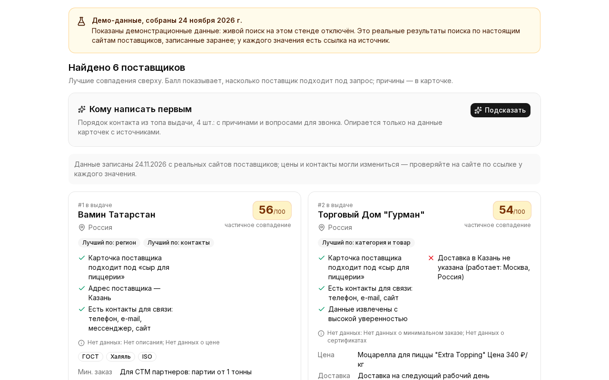
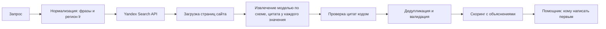

# FoodScout — поиск и сравнение поставщиков для food-сегмента

Прототип: **{PROD_URL}** · Репозиторий: https://github.com/Selogaz/foodscout

FoodScout помогает закупщику, технологу или владельцу небольшого food-бизнеса найти поставщиков
ингредиентов, готовой продукции и упаковки в нужном регионе, собрать структурированные карточки со
ссылками на источники и понять, **кому написать первым**.

Главный принцип: сервис ничего не додумывает. У каждого значения есть ссылка на страницу-источник и
уровень уверенности; если данных нет, поле помечено «нет данных».

## Как попробовать

1. Нажмите любую кнопку «Попробовать пример»: записанный результат настоящего поиска откроется сразу, с
   пометкой «Записанный пример» и датой записи.
2. Введите свой запрос (категория и город). При включённом живом поиске он идёт по шагам с прогрессом и
   занимает 32–50 секунд (по семи записанным прогонам). При ошибке, таймауте или исчерпанном лимите
   показывается ближайший записанный пример с пояснением причины.

## Что умеет сервис



- **Запрос.** Категория, город или регион, товар и фильтры: сертификаты, максимальный минимальный заказ,
  доставка, важность цены. Состояние формы хранится в адресе страницы.
- **Выдача с объяснениями.** Поставщики отсортированы по баллу; у каждого написано, что совпало и чего не
  хватает («Доставка в Казань не указана»).
- **«Кому написать первым».** Порядок контакта с причинами, оговорками по региону и вопросами для первого
  звонка; черновик запроса коммерческого предложения.
- **Карточка, сравнение, шортлист.** Все поля с источниками; сравнение до пяти поставщиков; шортлист со
  статусом, тегами, заметками и выгрузкой в CSV.

## Как это устроено



Шаги лежат в `src/server/pipeline`, прогресс каждого стримится в интерфейс.

1. **Нормализация.** Запрос превращается в несколько поисковых фраз; место приводится к справочнику
   регионов и коду региона Яндекса (`lr`).
2. **Поиск и загрузка.** Из выдачи убираются агрегаторы, маркетплейсы и розница. Страницы грузятся своим
   кодом: таймауты, лимит размера, `robots.txt`, страницы «контакты», «доставка», «оптовикам».
3. **Извлечение.** Модель возвращает JSON строго по схеме (Zod); к каждому значению обязательна цитата
   из текста страницы.
4. **Проверка цитат кодом.** Цитата ищется на странице, числа и единицы сверяются с её текстом. Для
   минимального заказа нужно подтвердить количество или единицу; цитаты о доставке и самовывозе
   отбрасываются; совпадение по отдельным словам снижает уверенность.
5. **Дедупликация и валидация.** Одна компания — одна карточка (домен, телефон или e-mail); значение
   без источника схема не принимает.
6. **Скоринг.** Детерминированная функция, модель не ранжирует. Веса: категория и товар 25, регион 25,
   фильтры запроса 20, контакты 12, полнота 10, надёжность данных 8. Набранное делится на сумму активных
   весов (100 с фильтрами, 80 без них) и умножается на `0,2 + 0,8 × совпадение категории и товара`, чтобы
   чужая категория не попала в топ. Отсутствие данных по запрошенному условию даёт 0 баллов за него.
7. **Помощник.** Модель получает только факты с источниками. Код проверяет ответ: ссылки на поставщиков и
   поля существуют, числа есть в данных, подтверждение региона считает код. При любом сбое (нет ключа,
   таймаут, невалидный ответ, лимит) пользователь получает шаблонный ответ без модели.

## Ключевые решения и компромиссы

- **Веб-сервис, а не чат.** Задача рабочая: найти, сравнить, выбрать, сохранить. Модель делает только то,
  что нельзя сделать правилами (разобрать текст сайта); проверка, дедупликация и ранжирование — код.
- **Яндекс как поисковик.** Для небольших региональных производителей с простыми сайтами качество определяется
  индексом Рунета, а не моделью. У Яндекса нативный фильтр региона (`lr`), он доступен из России с оплатой в
  рублях, а модели Yandex AI Studio подключаются по OpenAI-совместимому API.
- **Провайдеры за интерфейсами** `SearchProvider` и `LlmProvider`: смена модели — переменная `LLM_MODEL`,
  любой OpenAI-совместимый endpoint подключается через `LLM_BASE_URL` и `LLM_API_KEY`.
- **Демо-режим.** Прототип должен открываться у проверяющего с первого раза, без ключей и сети.

| `DEMO_MODE` | Поведение |
|---|---|
| `auto` | Точно совпавший запрос (кнопки-примеры) отдаётся из записи мгновенно и бесплатно. Собственный запрос идёт в живой поиск; при отсутствии ключа, ошибке, таймауте или исчерпанном суточном лимите показывается ближайшая запись с пометкой причины |
| `on` | Только записанные данные, сеть и ключи не нужны |
| `off` | Только живой поиск, ошибка не заменяется демо |

Записано 7 реальных прогонов (32 карточки); данные физических лиц, ИП и розничных сетей убраны.

## Качество

**Выбор модели.** Мини-эвал на 10 реальных сайтах (9 поставщиков и 1 агрегатор как отрицательный пример):
страницы заморожены, у всех моделей одинаковые вход и промпт, JSON по схеме, `temperature 0`, разметка
ручная.

| Модель | Точность полей | Выдуманные цитаты | Время на сайт | Цена на 10 сайтов |
|---|---|---|---|---|
| Qwen3.6 35B A3B | 96,8 % | 3 из 97 | 1,9 с | 14,6 ₽ |
| **DeepSeek V4.1 Flash** | **98,4 %** | **0 из 117** | 8,3 с | 30,1 ₽ |
| Alice AI LLM | 80,0 % | 0 из 77 | 17,1 с | 35,4 ₽ |

Выбрана DeepSeek V4.1 Flash: лучшая точность и ни одной выдуманной цитаты. Qwen вдвое дешевле и быстрее,
но придумал три цитаты, а для сервиса «без выдумок» это решающий довод. Эвал показал и главное: модели
«дорисовывают» значения вокруг настоящих цитат, поэтому проверка цитат кодом стала обязательным шагом.

**Тесты.** 245 юнит- и компонентных теста (Vitest): схемы, скоринг, пайплайн на моках, проверка цитат,
API и режимы демо, помощник, шортлист, компоненты. 9 e2e-тестов (Playwright) в демо-режиме, включая путь
от запроса до выгрузки CSV. Проверка доступности (axe) на всех экранах при 1280 и 390 px: нарушений
уровня critical и serious нет; тач-цели не меньше 44 px, горизонтальной прокрутки на мобильном нет.

## Стоимость и время

Живой поиск стоил 14–28,5 ₽ и занимал 32–50 секунд (семь записанных прогонов), вызов помощника — порядка
1–3 ₽. Расходы ограничены суточными лимитами, лимитом запросов с IP и кешем на 6 часов (см. переменные).

## Запуск локально

Next.js нужен Node.js 20.9+; для разработки и всех тестов подойдут Node.js 22.13+ в ветке 22 или 24+.
Проект проверен на Node.js 25.9.

```bash
npm ci
cp .env.example .env.local   # ключи нужны только для живого поиска
npm run dev                  # http://localhost:3000
```

Без ключей сервис работает в демо-режиме: примеры открываются, собственные запросы получают ближайший
записанный результат с пометкой. Проверки: `npm run lint`, `npm run typecheck`, `npm test`,
`npm run e2e` (нужен chromium: `npx playwright install chromium`; e2e сам собирает приложение, идёт на
порту 3100 в `DEMO_MODE=on`, не обращается к сети и не тратит бюджет).

**Ключ для живого поиска.** В Yandex Cloud создайте платёжный аккаунт и каталог (`YANDEX_FOLDER_ID`),
сервисный аккаунт с ролями `ai.languageModels.user` и `search-api.webSearch.user` и его API-ключ
(`YANDEX_API_KEY`).

| Переменная | Назначение | По умолчанию |
|---|---|---|
| `YANDEX_API_KEY`, `YANDEX_FOLDER_ID` | Доступ к Search API и моделям AI Studio | пусто (демо) |
| `LLM_MODEL` | Модель AI Studio | `deepseek-v4.1-flash` |
| `LLM_BASE_URL`, `LLM_API_KEY` | Другой OpenAI-совместимый endpoint | пусто |
| `DEMO_MODE` | `auto`, `on` или `off` | на проде `on`, в разработке `auto` |
| `LIVE_SEARCH_DAILY_LIMIT` | Живых поисков в сутки на инстанс | 5 |
| `RATE_LIMIT_PER_MINUTE` | Поисков в минуту с одного IP | 5 |
| `LIVE_SEARCH_TIMEOUT_S` | Таймаут живого поиска, с | 100 |
| `SEARCH_CACHE_TTL_MIN` | Время жизни кеша, мин | 360 |
| `ASSIST_RATE_LIMIT_PER_MINUTE`, `ASSIST_DAILY_LLM_LIMIT`, `ASSIST_TIMEOUT_S` | Помощник: запросов с IP в минуту, вызовов модели в сутки на инстанс, таймаут в секундах | 15, 50, 25 |

## Настройка на Vercel

1. В окружении Production задайте `YANDEX_API_KEY` и `YANDEX_FOLDER_ID`.
2. Явно задайте `DEMO_MODE=auto`: по умолчанию продакшн работает в режиме `on` и показывает только
   записанные примеры.
3. Оставьте лимиты `LIVE_SEARCH_DAILY_LIMIT=5` и `ASSIST_DAILY_LLM_LIMIT=50` (или задайте свои) и
   выполните деплой с этими переменными.

## Ограничения и развитие

- **Кеш и лимиты в памяти инстанса.** Холодный старт обнуляет счётчики, при нескольких инстансах общий
  расход может превысить лимит одного. Развитие: общее хранилище (Redis, KV).
- **Региональная выдача.** По некоторым городам (например, Казань) Яндекс даже с `lr` отдаёт много
  московских компаний. Регион считается по найденным адресам и доставке, помощник подчёркивает, у кого он
  подтверждён.
- **Открытый Рунет.** Закрытые B2B-площадки, каталоги с логином и платные API каталогов не используются.
- **Данные устаревают.** У каждого результата есть дата сбора; цены и контакты нужно проверять по ссылке.
- **Шортлист в `localStorage` браузера.** Развитие: серверная база, учётные записи, общие шортлисты.
- **Интеграции.** Есть выгрузка в CSV; дальше CRM и таблицы, отправка запросов КП из сервиса,
  мониторинг изменения цен и контактов.
